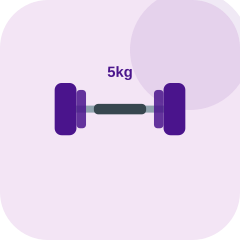

  

  

<h3 align="center">Hệ thống quản lý và bán dụng cụ thể thao – Nhóm 7</h3>

  
  
  

## Danh mục

  
  
  
  
  
  
  

## Cấu trúc thư mục

| Thành phần | Công nghệ / Mô tả | Đường dẫn |
|---|---|---|
| **Web bán hàng** (khách hàng) | ASP.NET Core MVC, .NET 10 | `ChuongTrinh/SourceCode/Clients/` |
| **Quản trị** (admin) | Windows Forms, .NET Framework 4.8 | `ChuongTrinh/SourceCode/Admin/` |
| **Cơ sở dữ liệu** | SQL Server (`SportZoneDB`, 11 bảng) | `ChuongTrinh/Database/SportZoneDB.sql` |
| **Báo cáo đồ án** | Báo cáo Word & PDF Nhóm 7 | `BaoCao/` |

## Chạy nhanh

1. Cài **Visual Studio 2022 (17.14+) / 2026** với workload *ASP.NET and web development* và *.NET desktop development*, cùng **SQL Server Express hoặc LocalDB**.
2. Mở **`SportZone.sln`** → chuột phải solution → *Configure Startup Projects* → *Multiple startup projects* → chọn **Start** cho cả `SportZoneAdmin` và `SportZoneWeb`.
3. Bấm **F5**. CSDL được **tự tạo** lần chạy đầu.

| | Địa chỉ / tài khoản |
|---|---|
| Web | http://localhost:5080 — `nguyenvana` / `123456` |
| Admin | `admin` / `admin123` |
| Mã giảm giá | `SPORT10`, `CHAOHE20` |
